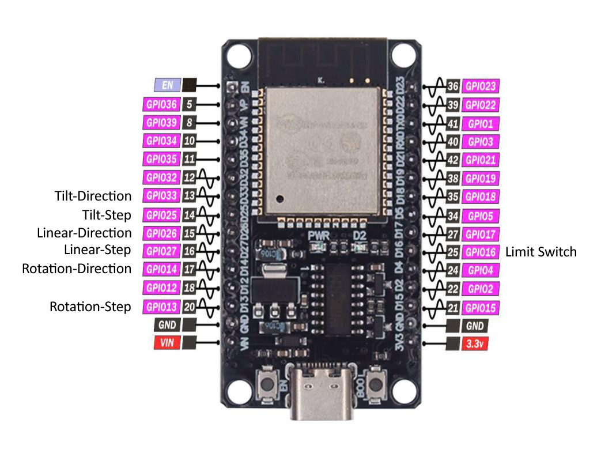

# ESP32 3 Axis Camera Slider


A wifi based 3 axis camera slider with up to 5 programmable keyframes!

[Project Video Link](https://youtu.be/oJCAlG4-4G4)

Features
------

- 3 Axis of Movement
- Payload weight of up to 1.4kg's tested!
- ESP32 Wifi Based control. No additional controller hardware required!
- 5 Programmable keyframes with configurable move times and delays
- Works with all Step/Direction based stepper motor controllers
- Smooth multi-axis acceleration on short moves
- Accurate timelapse moves as slow as 0.35mm per minute

Bill of Materials
------

2x 80t GT2 Pulley - https://www.aliexpress.com/item/1005009718089528.html

4x 608 Bearing - https://www.aliexpress.com/item/1005006416257891.html

2x 625 Bearing - https://www.aliexpress.com/item/1005006035549112.html

2x GT2 230mm Belt - https://www.aliexpress.com/item/1005006417887084.html

4x GT2 20t 5mm Bore - https://www.aliexpress.com/item/1005010499786326.html

4x Ender Style V Wheels - https://www.aliexpress.com/item/1005003090749056.html

3x Nema 17 34mm Length - https://www.aliexpress.com/item/1005004696195501.html

1x V-Slot 2060 Extrusion - https://www.aliexpress.com/item/1005006871313607.html

1x 6mm GT2 Timing Belt - https://www.aliexpress.com/item/32952396111.html

2x 5mm Diameter 20mm long Spring - https://www.aliexpress.com/item/1005002450432704.html

1x ESP32 Development Board - https://www.aliexpress.com/item/1005006458998450.html

1x 5v Regulator - https://www.aliexpress.com/item/1005006005553178.html

You'll also need 3x Stepper motor drivers of your choice. I used the MKS Servo42C drivers for mine, but I had quite a few problems with them so I'll leave this bit up to you.

Hardware
------

12x M3x8 SHCS

4x M3x6 SHCS

14x M3x12 SHCS

4x M3x40 SHCS

8x M3x8 CSK

12x M3 2020 T-Nuts

1x M8x25 SHCS

1x M8x30 SHCS

1x M8 Nyloc Nut

2x 8mm Washer

7x M5x35 SHCS

2x M5x20 SHCS

4x M5 Nyloc Nuts

4x 5mm Washer

2x M2x8 SHCS

1x M6 Nyloc

1x M6x60 SHCS


Instructions
======

To complete the build in the same way I did for the video, follow the steps below. I have also provided the full assembly in .STEP format so you can choose how to make parts yourself if you wish.

3D Printing
------

In the 3D files folder, there is a folder called 3D Print. Each file has a quantity at the beginning of the file name (for example, 2x means two required).
With the exception of the electrical box and the linear plate cover, everything else should be printed with strength in mind. PETG on the strength preset is the bare minimum required for these parts.

Laser Cutting
------

The folders "Tilt Bracket" and "Tripod Mount Plate" are for parts that require laser cutting.

### Tripod Mount Plate

There are three files in this folder, a .STEP, .DXF and .PDF file. Some laser cutting suppliers will want a .STEP file whilst others may instead want the .DXF. They may even ask for both which is fine. The PDF file contains information for the tripod thread that needs to be tapped into the plate so it should be provided along with the other files if you're expecting the plate to arrive with a thread already tapped.

I would recommend getting at least two of the tripod mounting plates made, as you may want to support the slider with more than one tripod to increase stability with heavy loads.

### Tilt Bracket

This folder also has three files of the same types as above but because it is a folded sheet metal part, the process may be a bit different. The DXF file just contains a flat pattern of the two parts required to make this part. This is all you should send for cutting if you are planning to fold and weld the part yourself.

If you have found a supplier than can also fold and weld parts, the PDF contains folding and weld instructions and should be provided to the supplier. The STEP file contains a complete model of the part and may also be requested in this case.

Machining
------

### Slider Plate

The slider plate folder contains the same 3 files again. This part should be machined from aluminium and can be anodised if you wish. Most suppliers will want the STEP file for machining but I've supplied a DXF as well which some suppliers may want. The PDF for this part contains the information for tapping the threads needed in the plate and should be provided alongside the other files if you don't want to tap the threads yourself.

### 80t Pulley

This folder contains two files. If you've purchased pulleys like I did and are having them machined, the PDF should be enough information for your machinist to complete the job. Keep in mind you will need BOTH pulleys machined the same way.

There is a .STEP file included that should have an accurate enough tooth profile that you could potentially have someone machine the pulley from billet but I really wouldn't recommend this approach as it will probably end up being far more expensive. 

You could also try 3D printing this part if your payload is only ever going to be much lighter than mine but I wouldn't reccomend this approach for a heavy camera gear as there is a lot of load on these pulleys.

Wiring
------

The pin assignments for the three drives and the limit switch are shown here:



Not all development boards are the same layout, so make sure you follow the GPIO or pin numbers rather than just counting pins on the picture. You can also change which pins are used in the software if you can't use the pins I've chosen, but proceed with caution as there are a number of pins on the esp32 that can prevent the board from booting if they are used.

The other side of your limit switch should be connected to one of the GND pins. Please note, most limit switches have three pins, one pair are normally open and the other pair are normally closed. The normally open terminals on the switch should be used for this project.

You will also need to provide power to the +5v and GND pins on the ESP32 using the 5v regulator (or similar) linked above. Some stepper drivers like the servo42c's that I used require a logic voltage level to be supplied as well. If that is the case, you will need to connect the 3.3v pin on the ESP32 board to the appropriate pin on your stepper drivers.

Software
------

Before you begin, you will need to install the MultiStepperLite library along with the "esp32 by Espressif Systems" boards package for this code to compile and upload. I've included all of the user configurable settings in a section at the top of CameraSlider.ino with comment tags around them to make it easy to tell what you're allowed to change.

If you've copied my build exactly, the only thing you should need to do to get up and running is to replace these fields with your Wifi SSID and Password. Make sure you keep the "" and just replace the words.
```
const char* ssid = "YOURSSID"; //Enter your wifi SSID here
const char* password = "YOURPASSWORD"; //Enter your wifi Password here
```
Once the controller is running, you can then access the controls by visiting https://slider.local in your browser.

If the controller fails to connect to your wifi, it will host its own Access Point using the SSID: "ESP32-Slider" and Password: "12345678"

mSDN won't work in Access Point mode, so you'll need to visit http://192.168.4.1 instead if you're connected to the AP.

This value lmiits the travel of the Linear axis and it should be set to match the length of your slider extrusion, minus the width of the carriage. If you built my design, the carriage width is 110mm.
```
int maxX = 650;
```

These values should be checked to ensure they match your gear ratio, motor steps/revolution and controller microstepping settings. xAxisPulleyT is the number of Teeth on your linear axis pulley and toothPitch is simply the distance between the teeth on the belt, which for GT2 belt is 2mm.

The R, T and X Steps values that follow are simply your motors steps/revolution. Most stepper motors are 1.8 degrees per step which is 200 but check your motors datasheet if you aren't sure! (360 degrees / 1.8 = 200)

```
int MICROSTEPS = 16;
int gearRatio = 4;
int xAxisPulleyT = 20;
int toothPitch = 2;

int R_AXIS_STEPSREV = 200;
int T_AXIS_STEPSREV = 200;
int X_AXIS_STEPSMM = 200;
```

The motor and limit switch IO is defined here. You can change it if needed but be careful as there are a number of pins that can't safely be used on the ESP32!

```
const int R_STEP_PIN = 13;
const int R_DIRECTION_PIN = 14;
const int X_STEP_PIN = 27;
const int X_DIRECTION_PIN = 26;
const int T_STEP_PIN = 25;
const int T_DIRECTION_PIN = 33;
const int X_AXIS_LIMIT = 16;
```

Finally, if you're having difficulties, be sure to set debug to true to enable verbose serial output. This will provide information from most of the steps of each calculation to help diagnose what is going on along with the controllers IP address if you're having trouble connecting.

```
bool debug = false; //Set to true for debug serial output
```

If you have any motion related bugs to report, please include a screenshot of your set keyframes, along with the opperation you were trying to perform (for example, set keyframe, Begin, move to keyframe etc). I'll also need a copy of the configuration settings we just covered, just obviously DON'T post your WIFI credentials as the reported issues are posted publicly and I don't need them for testing.