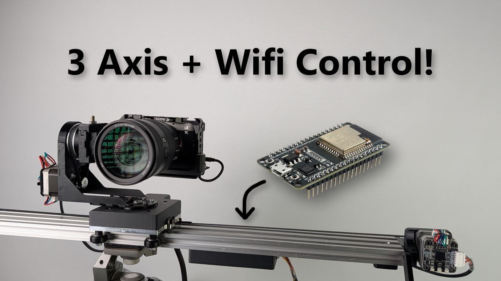

# ESP32_3Axis_CameraSlider

A wifi based 3 axis camera slider with up to 5 programmable keyframes!

[Project Video Link](https://youtu.be/oJCAlG4-4G4)

Features
------

- 3 Axis of Movement
- Payload weight of up to 1.4kg's tested!
- ESP32 Wifi Based control. No additional controller hardware required!
- 5 Programmable keyframes with configurable move times and delays
- Works with all Step/Direction based stepper motor controllers
- Smooth multi-axis acceleration on short moves
- Timelapse moves as slow as 10mm/hour possible.

Bill of Materials
------

2x 80t GT2 Pulley - https://www.aliexpress.com/item/1005009718089528.html

4x 608 Bearing - https://www.aliexpress.com/item/1005006416257891.html

2x GT2 230mm Belt - https://www.aliexpress.com/item/1005006417887084.html

4x GT2 20t 5mm Bore - https://www.aliexpress.com/item/1005010499786326.html

4x Ender Style V Wheels - https://www.aliexpress.com/item/1005003090749056.html

3x Nema 17 34mm Length - https://www.aliexpress.com/item/1005004696195501.html

1x V-Slot 2060 Extrusion - https://www.aliexpress.com/item/1005006871313607.html

1x 6mm GT2 Timing Belt - https://www.aliexpress.com/item/32952396111.html

1x ESP32 Development Board - https://www.aliexpress.com/item/1005006458998450.html

1x 5v Regulator - https://www.aliexpress.com/item/1005006005553178.html

You'll also need 3x Stepper motor drivers of your choice. I used the MKS Servo42C drivers for mine, but I had quite a few problems so I'll leave this bit up to you.

Hardware
------

8x M3x8 SHCS

4x M3x6 SHCS

14x M3x12 SHCS

4x M3x40 SHCS

8x M3x8 CSK

12x M3 2020 T-Nuts

Instructions
======

To complete the build in the same way I did for the video, follow the steps below. I have also provided the full assembly in .STEP format so you can choose how to make parts yourself if you wish.

3D Printing
------

In the 3D files folder, there is a folder called 3D Print. Each file has a quantity at the beginning of the file name (for example, 2x means two required).
With the exception of the electrical box and the linear plate cover, everything else should be printed with strength in mind. PETG on the strength preset is the bare minimum required for these parts.

Laser Cutting
------

The folders "Tilt Bracket" and "Tripod Mount Plate" are for parts that require laser cutting.

### Tripod Mount Plate

There are three files in this folder, a .STEP, .DXF and .PDF file. Some laser cutting suppliers will want a .STEP file whilst others may instead want the .DXF. They may even ask for both which is fine. The PDF file contains information for the tripod thread that needs to be tapped into the plate so it should be provided along with the other files if you're expecting the plate to arrive with a thread already tapped.

I would recommend getting at least two of the tripod mounting plates made, as you may want to support the slider with more than one tripod to increase stability with heavy loads.

### Tilt Bracket

This folder also has three files of the same types as above but because it is a folded sheet metal part, the process may be a bit different. The DXF file just contains a flat pattern of the two parts required to make this part. This is all you should send for cutting if you are planning to fold and weld the part yourself.

If you have found a supplier than can also fold and weld parts, the PDF contains folding and weld instructions and should be provided to the supplier. The STEP file contains a complete model of the part and may also be requested in this case.

Machining
------

### Slider Plate

The slider plate folder contains the same 3 files again. This part should be machined from aluminium and can be anodised if you wish. Most suppliers will want the STEP file for machining but I've supplied a DXF as well which some suppliers may want. The PDF for this part contains the information for tapping the threads needed in the plate and should be provided alongside the other files if you don't want to tap the threads yourself.

### 80t Pulley

This folder contains two files. If you've purchased pulleys like I did and are having them machined, the PDF should be enough information for your machinist to complete the job. Keep in mind you will need BOTH pulleys machined the same way.

There is a .STEP file included that should have an accurate enough tooth profile that you could potentially have someone machine the pulley from billet but I really wouldn't recommend this approach as it will probably end up being far more expensive. 

You could also try 3D printing this part if your payload is only ever going to be much lighter than mine. I wouldn't reccomend this approach for a heavy camera gear as there is a lot of load on these pulleys.

